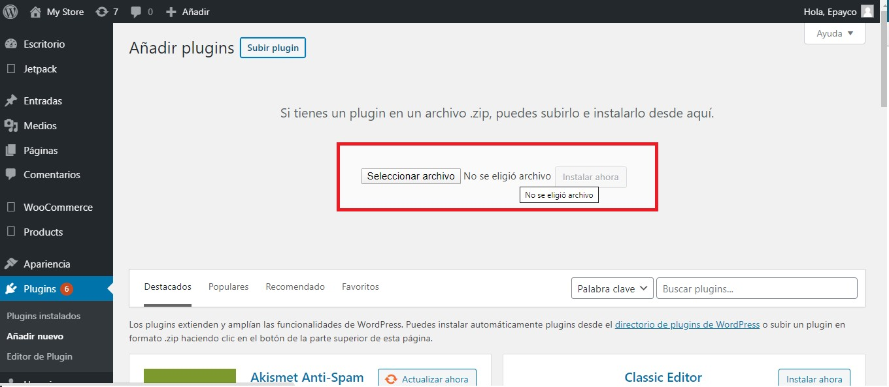
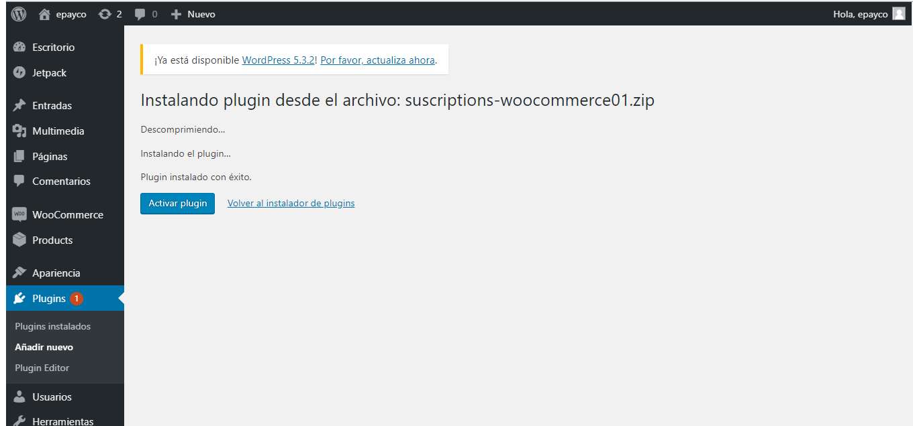
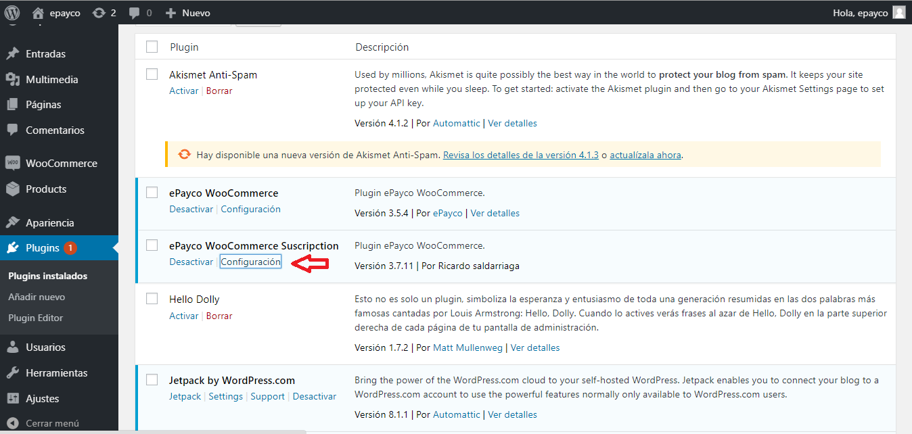
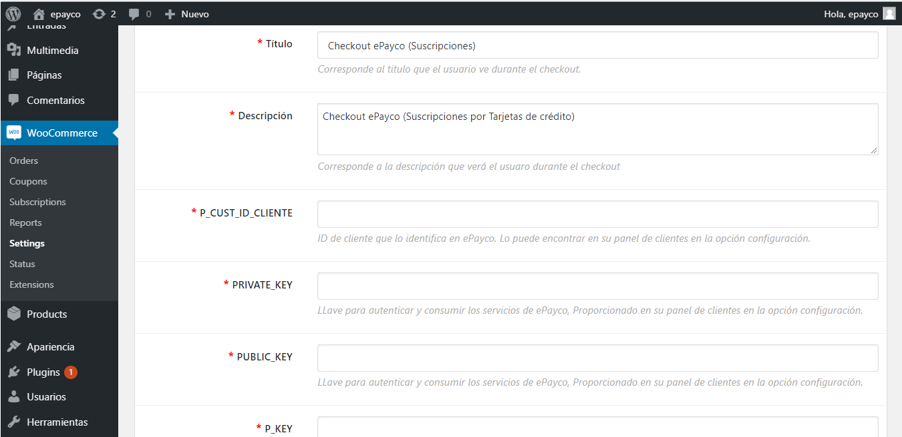
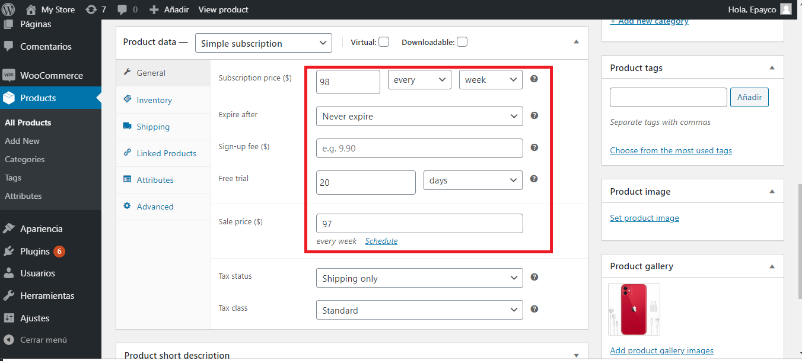
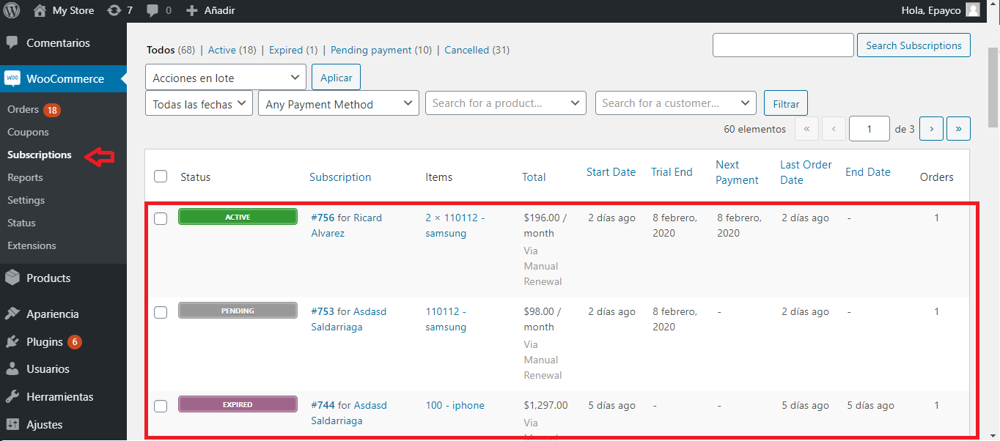
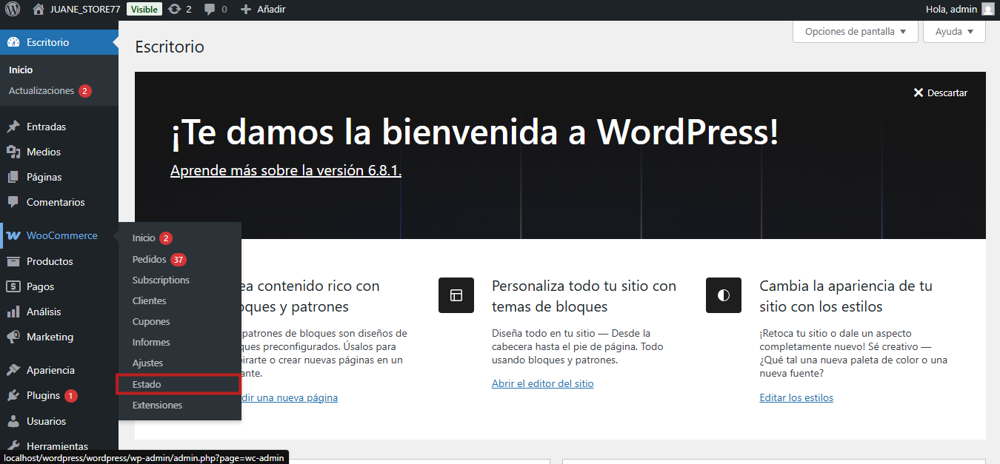
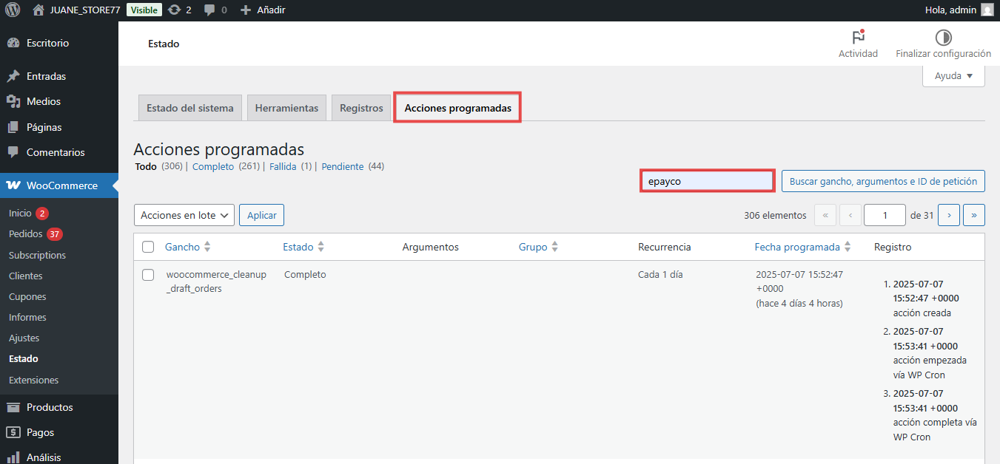
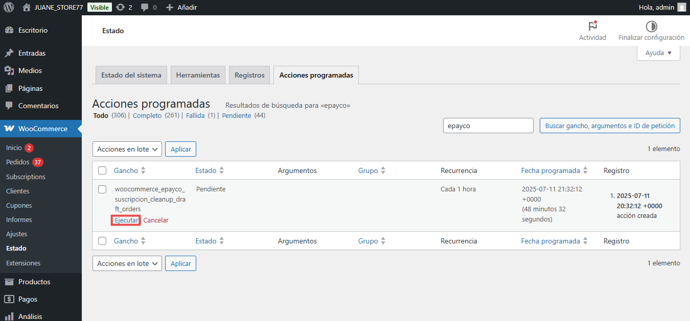
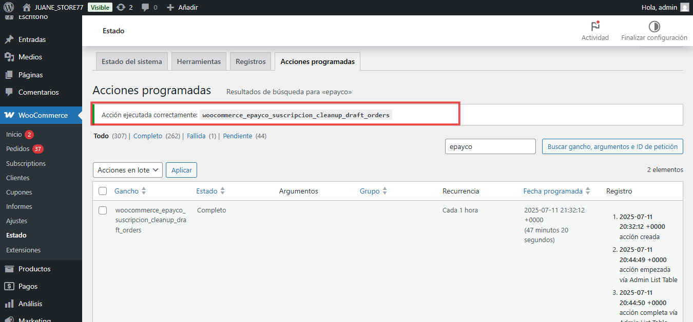

# Davipay Suscripciones Woocommerce

**Si usted tiene alguna pregunta o problema, no dude en ponerse en contacto con nuestro soporte técnico: desarrollo@davipay.com.**

## Tabla de contenido

- [Requisitos](#requisitos)
- [Instalación](#instalación)
- [Pasos](#pasos)
- [Versiones](#versiones)

## Requisitos

- Tener una cuenta activa en [Davipay](https://davipay.com/).
- Tener instalado WordPress versión 5.3.x o superior.
- WooCommerce versión 7.7.0 =>.
- WooCommerce Suscripcion versión 2.6.x o superior.
- Acceso a las carpetas donde se encuetra instalado WordPress y WooCommerce.
- Acceso al admin de WordPress.
- PHP >= 8.2

## Instalación

1. [Descarga el plugin.](https://github.com/epayco/suscripciones_woocommerce#versiones)
2. Ingresa al administrador de tu wordPress.
3. Ingresa a Plugins / Añadir-Nuevo / Subir-Plugin.
4. Busca el plugin descargado en tu equipo y súbelo como cualquier otro archivo.
5. Después de instalar el .zip lo puedes ver en la lista de plugins instalados , puedes activarlo o desactivarlo.
6. Para configurar el plugin debes ir a: WooCommerce / Ajustes / Pagos y Ubica la pestaña Davipay.
7. Configura el plugin ingresando el **P_CUST_ID_CLIENTE**,**P_KEY**, **PRIVATE_KEY**,**PUBLIC_KEY** , los puedes ver en tu [panel de clientes](https://secure.payco.co/clientes/).
8. Selecciona o crea una página de respuesta donde el usuario será devuelto después de finalizar la compra (por defecto el sistema redirecciona a la pagina de gracias de Woocommerce).
9. Configurar los productos en el panel de Wordpress: WooCommerce / Productos
   con los respectivos valores para la suscripcion
10. Realiza una o varias compras para comprobar que todo esté bien.
11. Si todo está bien recuerda cambiar la variable Modo Prueba a NO y empieza a recibir pagos de forma instantánea y segura con Davipay.
12. Tener en cuenta que para la cancelación de la suscripciones se debe de realizar por medio del [dashboard](https://dashboard.davipay.com/v3/login) donde encontrar la información de la suscripcion y podra realizar la cancelación de esta.

## Tarea programada para realizar las actualizaciones del estado de las suscripciones

1. Ingresa al administrador de tu WordPress.
2. Ingresa a WooCommerce / Estado / Acciones programadas.
3. Busca por gancho, argumentos e ID de petición y agrega el nombre de Davipay.
4. Aparecerá la tarea programada con el nombre (woocommerce_davipay_suscripción_cleanup_draft_orders) y haz clic en Ejecutar.
5. Te aparecerá un mensaje de confirmación diciéndote que la tarea programada se ejecutó correctamente.
6. Con estos pasos anteriores los estados de tu suscripción se actualizarán correctamente, manteniendo así sincronizado el estado de la suscripción en tu dashboard de Davipay con el estado de tus suscripciones en WooCommerce.

## Pasos

## Pasos para ejecutar la Acción programada

## Versiones
- [Davipay plugin WooCommerce v7.0.0](https://github.com/epayco/suscripciones_woocommerce/releases/tag/7.0.0)
- [Davipay plugin WooCommerce v6.6.3](https://github.com/epayco/suscripciones_woocommerce/releases/tag/6.6.3)
- [Davipay plugin WooCommerce v6.6.2](https://github.com/epayco/suscripciones_woocommerce/releases/tag/6.6.2)
- [Davipay plugin WooCommerce v6.6.1](https://github.com/epayco/suscripciones_woocommerce/releases/tag/6.6.1)
- [Davipay plugin WooCommerce v6.6.0](https://github.com/epayco/suscripciones_woocommerce/releases/tag/v6.6.0)
- [Davipay plugin WooCommerce v6.5.3](https://github.com/epayco/suscripciones_woocommerce/releases/tag/v6.5.3)
- [Davipay plugin WooCommerce v6.5.2](https://github.com/epayco/suscripciones_woocommerce/releases/tag/v6.5.2)
- [Davipay plugin WooCommerce v6.5.1](https://github.com/epayco/suscripciones_woocommerce/releases/tag/v6.5.1)
- [Davipay plugin WooCommerce v6.5.0](https://github.com/epayco/suscripciones_woocommerce/releases/tag/v6.5.0)
- [Davipay plugin WooCommerce v6.4.4](https://github.com/epayco/suscripciones_woocommerce/releases/tag/v6.4.4)
- [Davipay plugin WooCommerce v6.4.3](https://github.com/epayco/suscripciones_woocommerce/releases/tag/v6.4.3)
- [Davipay plugin WooCommerce v6.4.2](https://github.com/epayco/suscripciones_woocommerce/releases/tag/v6.4.2)
- [Davipay plugin WooCommerce v6.4](https://github.com/epayco/suscripciones_woocommerce/releases/tag/v6.4)
- [Davipay plugin WooCommerce v6.3](https://github.com/epayco/suscripciones_woocommerce/releases/tag/v6.3)
- [Davipay plugin WooCommerce v6.2](https://github.com/epayco/suscripciones_woocommerce/releases/tag/v6.2)
- [Davipay plugin WooCommerce v6.1](https://github.com/epayco/suscripciones_woocommerce/releases/tag/v6.1)
- [Davipay plugin WooCommerce v6.0](https://github.com/epayco/suscripciones_woocommerce/releases/tag/v6.0)
- [Davipay plugin WooCommerce v5.2](https://github.com/epayco/suscripciones_woocommerce/releases/tag/v5.2)
- [Davipay plugin WooCommerce v5.1](https://github.com/epayco/suscripciones_woocommerce/releases/tag/v5.1)
- [Davipay plugin WooCommerce v5.0](https://github.com/epayco/suscripciones_woocommerce/releases/tag/v5.0)
- [Davipay plugin WooCommerce v4.9](https://github.com/epayco/suscripciones_woocommerce/releases/tag/v4.9).
- [Davipay plugin WooCommerce v4.3](https://github.com/epayco/suscripciones_woocommerce/releases/tag/v4.3).
- [Davipay plugin WooCommerce v4.x](https://github.com/epayco/suscripciones_woocommerce/releases/tag/v4.x).
- [Davipay plugin WooCommerce v3.9.x](https://github.com/epayco/suscripciones_woocommerce/releases/tag/v2.6).
